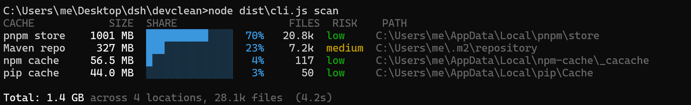
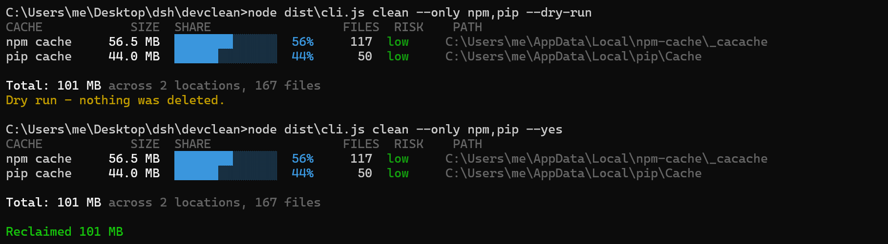
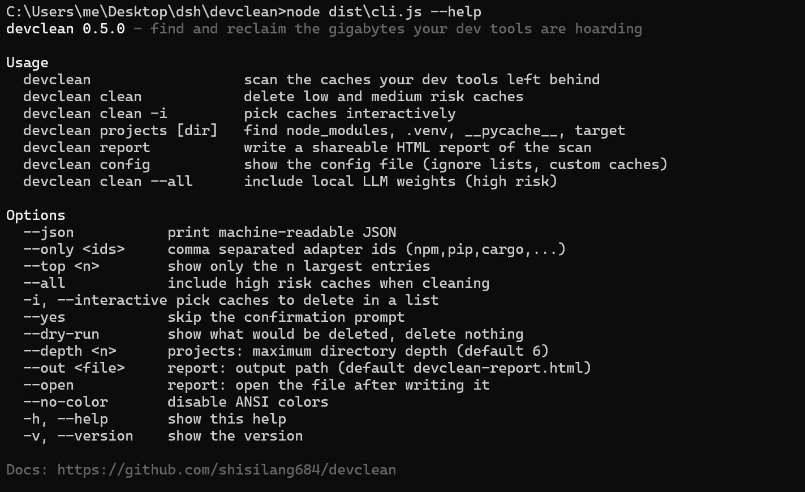

# devclean

English | [简体中文](README.zh-CN.md)

[](https://github.com/shisilang684/devclean/actions/workflows/ci.yml)

**Your dev machine is hoarding gigabytes. Find them, see them, reclaim them.**

`devclean` scans every cache your toolchain quietly accumulated - npm, pnpm, pip, Cargo, Gradle, Playwright browsers, Hugging Face models, local LLM weights - and shows you exactly what is safe to delete. One command, no config, no telemetry.



```
$ npx devclean

CACHE             SIZE  SHARE            FILES  RISK    PATH
pnpm store     1001 MB  ██████████░░░░   20.8k  low     C:\Users\me\AppData\Local\pnpm\store
Maven repo      327 MB  ███░░░░░░░░░░░    7.2k  medium  C:\Users\me\.m2\repository
npm cache      56.5 MB  █░░░░░░░░░░░░░     117  low     C:\Users\me\AppData\Local\npm-cache\_cacache
pip cache      44.0 MB  ░░░░░░░░░░░░░░      50  low     C:\Users\me\AppData\Local\pip\Cache

Total: 1.4 GB across 4 locations, 28.1k files  (4.2s)
Reclaim 1.4 GB with devclean clean
```

## Why

Every package manager keeps a cache. Every AI tool downloads model weights. Every project grows a `node_modules`. Individually they look harmless; together they quietly eat 20-100 GB of your disk - and no single tool sees all of them.

Most cleaners either max out at `node_modules` or treat your downloaded LLM weights like disposable files. `devclean` knows the difference.

## Quick start

```bash
npx devclean              # scan known caches
npx devclean clean        # delete low + medium risk caches (asks first)
npx devclean clean -i     # pick caches interactively
npx devclean projects .   # find node_modules/.venv/target inside your projects
npx devclean report       # write a shareable HTML report
```

Requires Node.js 20+. Works on Windows, macOS, and Linux. You can also install straight from
GitHub: `npm i -g github:shisilang684/devclean`.

## What it looks like

`clean -i` puts every cache in a checkbox list. Arrow keys move, space toggles, `a` selects all low and medium risk, enter shows the plan before anything is deleted:


Then it reports what actually happened, not what it hoped would happen:



The full command surface is small enough to read in one screen:



## What it scans

22 cache families, each with an honest risk label.

| Cache | Risk | What it is |
| --- | --- | --- |
| npm, pnpm, Yarn, Bun | low | Package tarballs, re-downloaded on demand |
| pip, uv | low | Python wheels and HTTP cache |
| Cargo registry, Go build cache | low | Compiled and downloaded build inputs |
| Gradle, Maven | low / medium | Dependency caches |
| Playwright, Puppeteer | low | Browser binaries |
| NuGet, Composer, sbt / Ivy | medium / low | .NET, PHP and Scala dependency caches |
| conda | medium | Package archives shared with conda environments |
| Deno, Cypress, Electron | low | Runtime, browser and app binaries |
| Hugging Face | medium | Model and dataset downloads |
| Ollama, LM Studio | **high** | Local LLM weights - deleting forces a full re-pull |

`clean` skips high-risk caches unless you pass `--all`. Nothing is deleted without showing you the list and the total first.

## How it compares

|  | `devclean` | `npkill` | GUI disk cleaners | `du` + `rm -rf` |
| --- | --- | --- | --- | --- |
| Package caches (npm, pnpm, pip, Cargo, Gradle...) | all 22, one pass | `node_modules` only | generally not cache-aware | only the paths you already know |
| Local LLM weights (Ollama, LM Studio) | yes, high risk and opt-in | no | often treated as ordinary junk | yes, with no warning |
| Risk label before anything is deleted | yes | no | partial | no |
| Project artifacts (`node_modules`, `.venv`, `target`) | yes, inside real projects only | `node_modules` only | no | manual |
| Shareable report | self-contained HTML treemap | no | no | no |
| Install | `npx devclean` | `npx npkill` | app install | already there |

The gap that matters is the second row: a cleaner that does not know the difference between
a 60 GB model download and a stale tarball will eventually delete something expensive.

## Custom caches and ignores

You can teach devclean about a cache it does not ship with, or hide one you do not care
about, without waiting for a release:

```bash
devclean config
```

That prints the config path (`%APPDATA%\devclean\config.json` on Windows,
`~/Library/Application Support/devclean/config.json` on macOS,
`~/.config/devclean/config.json` on Linux) and the current settings. A minimal file:

```json
{
  "ignore": ["maven"],
  "extra": [
    { "name": "Bazel cache", "path": "~/.cache/bazel", "risk": "medium" }
  ]
}
```

Paths must be absolute or start with `~`; `risk` defaults to `medium`. Set
`DEVCLEAN_CONFIG` to load a different file (handy for a shared CI config).

## Project artifacts

```
$ npx devclean projects ~/code

CACHE              SIZE  SHARE                  FILES  RISK    PATH
node_modules     2.1 GB  ███████████░░░  72%   88.4k  low     ~/code/shop\node_modules
.venv            612 MB  ████░░░░░░░░░░  20%   12.1k  low     ~/code/api\.venv
target           240 MB  █░░░░░░░░░░░░░   8%    3.2k  low     ~/code/cli\target
```

Only directories inside a real project (one with `package.json`, `pyproject.toml`, `Cargo.toml`, `.git`, ...) are reported, so the Python standard library and installed applications are never touched.

## Shareable reports

`devclean report` writes a single self-contained HTML file - no scripts loaded from the network, no data leaves your machine. It is handy for a team wiki, a "why is the CI runner out of disk" ticket, or just showing a colleague where their 80 GB went.


## Safety

- **Dry by default when you ask for it.** `--dry-run` prints the plan and deletes nothing.
- **Risk levels.** High-risk items (local LLM weights) are opt-in.
- **Allow-list.** `devclean` refuses to delete a path that is not a recognized cache or project artifact, even if a bug tried to.
- **Symlinks are never followed.** A cache cannot redirect the scan (or the delete) somewhere else.
- **Reports exclude high-risk items** from the reclaimable total, so a shared screenshot never overstates what is safe.
- **No telemetry, no network calls.** Everything happens locally.
- **Failures are reported, not hidden.** Locked files on Windows are listed with the error.
- **Auditable in one sitting.** ~1,500 lines of dependency-free TypeScript; the allow-list lives in `src/adapters.ts`.

Security reports: see [SECURITY.md](SECURITY.md).

## Scripting

```bash
npx devclean --json | jq '.totalBytes'
npx devclean clean --json --yes   # only deletes low + medium risk
npx devclean projects . --json
```

Exit codes: `0` success, `1` error.

## Options

```
--json           machine-readable output
--only <ids>     comma separated adapter ids (npm,pip,cargo,...)
--top <n>        show only the n largest entries
--all            include high risk caches when cleaning
-i, --interactive pick caches to delete in a list
--yes            skip the confirmation prompt
--dry-run        show what would be deleted, delete nothing
--depth <n>      projects: maximum directory depth (default 6)
--out <file>     report: output path (default devclean-report.html)
--open           report: open the file after writing it
--no-color       disable ANSI colors
```

## Roadmap

- [x] Interactive TUI (select what to delete with arrow keys)
- [ ] Growth tracking: "your caches grew 4.2 GB this week"
- [x] Shareable HTML report with a treemap
- [ ] Docker build cache and WSL disk usage
- [ ] `devclean watch` with a size budget

Ideas are welcome in [Issues](https://github.com/shisilang684/devclean/issues).

## Development

```bash
git clone https://github.com/shisilang684/devclean
cd devclean
npm install
npm run build
npm test
node dist/cli.js
```

Zero runtime dependencies. TypeScript, Node's built-in test runner.

## License

MIT