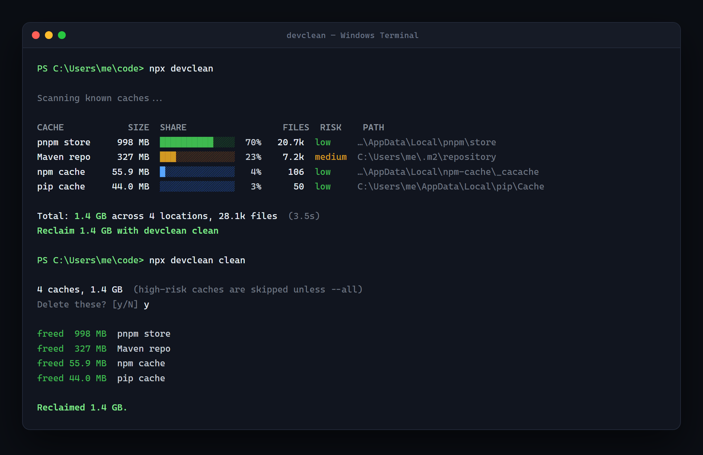
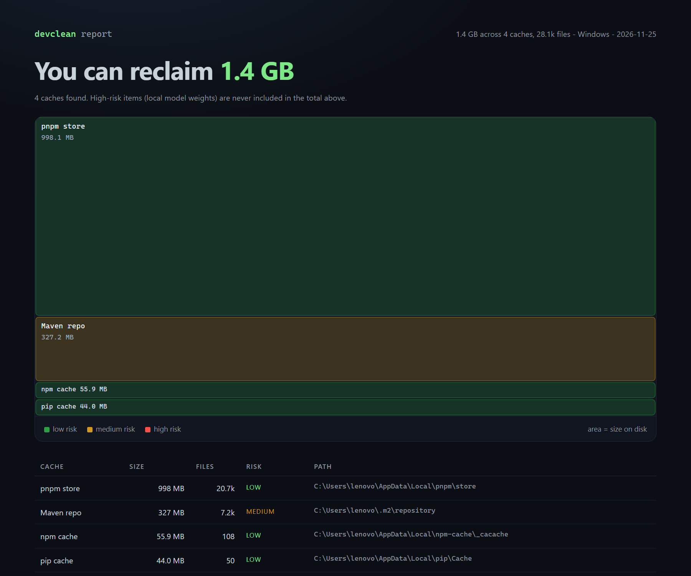

# devclean

English | [简体中文](README.zh-CN.md)

**Your dev machine is hoarding gigabytes. Find them, see them, reclaim them.**

`devclean` scans every cache your toolchain quietly accumulated - npm, pnpm, pip, Cargo, Gradle, Playwright browsers, Hugging Face models, local LLM weights - and shows you exactly what is safe to delete. One command, no config, no telemetry.



```
$ npx devclean

CACHE            SIZE  SHARE                  FILES  RISK    PATH
pnpm store     998 MB  ██████████░░░░  70%   20.7k  low     C:\Users\me\AppData\Local\pnpm\store
Maven repo     327 MB  ███░░░░░░░░░░░  23%    7.2k  medium  C:\Users\me\.m2\repository
npm cache     55.9 MB  █░░░░░░░░░░░░░   4%     106  low     C:\Users\me\AppData\Local\npm-cache\_cacache
pip cache     44.0 MB  ░░░░░░░░░░░░░░   3%      50  low     C:\Users\me\AppData\Local\pip\Cache

Total: 1.4 GB across 4 locations, 28.1k files  (3.5s)
Reclaim 1.4 GB with devclean clean
```

## Why

Every package manager keeps a cache. Every AI tool downloads model weights. Every project grows a `node_modules`. Individually they look harmless; together they quietly eat 20-100 GB of your disk - and no single tool sees all of them.

Most cleaners either max out at `node_modules` or treat your downloaded LLM weights like disposable files. `devclean` knows the difference.

## Quick start

```bash
npx devclean              # scan known caches
npx devclean clean        # delete low + medium risk caches (asks first)
npx devclean projects .   # find node_modules/.venv/target inside your projects
npx devclean report       # write a shareable HTML report
```

Requires Node.js 18+. Works on Windows, macOS, and Linux.

## What it scans

| Cache | Risk | What it is |
| --- | --- | --- |
| npm, pnpm, Yarn, Bun | low | Package tarballs, re-downloaded on demand |
| pip, uv | low | Python wheels and HTTP cache |
| Cargo registry, Go build cache | low | Compiled and downloaded build inputs |
| Gradle, Maven | low / medium | Dependency caches |
| Playwright, Puppeteer | low | Browser binaries |
| Hugging Face | medium | Model and dataset downloads |
| Ollama, LM Studio | **high** | Local LLM weights - deleting forces a full re-pull |

`clean` skips high-risk caches unless you pass `--all`. Nothing is deleted without showing you the list and the total first.

## Project artifacts

```
$ npx devclean projects ~/code

CACHE              SIZE  SHARE                  FILES  RISK    PATH
node_modules     2.1 GB  ███████████░░░  72%   88.4k  low     ~/code/shop\node_modules
.venv            612 MB  ████░░░░░░░░░░  20%   12.1k  low     ~/code/api\.venv
target           240 MB  █░░░░░░░░░░░░░   8%    3.2k  low     ~/code/cli\target
```

Only directories inside a real project (one with `package.json`, `pyproject.toml`, `Cargo.toml`, `.git`, ...) are reported, so the Python standard library and installed applications are never touched.

## Shareable reports

`devclean report` writes a single self-contained HTML file - no scripts loaded from the network, no data leaves your machine. It is handy for a team wiki, a "why is the CI runner out of disk" ticket, or just showing a colleague where their 80 GB went.



## Safety

- **Dry by default when you ask for it.** `--dry-run` prints the plan and deletes nothing.
- **Risk levels.** High-risk items (local LLM weights) are opt-in.
- **Allow-list.** `devclean` refuses to delete a path that is not a recognized cache or project artifact, even if a bug tried to.
- **No telemetry, no network calls.** Everything happens locally.
- **Failures are reported, not hidden.** Locked files on Windows are listed with the error.

## Scripting

```bash
npx devclean --json | jq '.totalBytes'
npx devclean clean --json --yes   # only deletes low + medium risk
npx devclean projects . --json
```

Exit codes: `0` success, `1` error.

## Options

```
--json           machine-readable output
--only <ids>     comma separated adapter ids (npm,pip,cargo,...)
--top <n>        show only the n largest entries
--all            include high risk caches when cleaning
--yes            skip the confirmation prompt
--dry-run        show what would be deleted, delete nothing
--depth <n>      projects: maximum directory depth (default 6)
--out <file>     report: output path (default devclean-report.html)
--open           report: open the file after writing it
--no-color       disable ANSI colors
```

## Roadmap

- [ ] Interactive TUI (select what to delete with arrow keys)
- [ ] Growth tracking: "your caches grew 4.2 GB this week"
- [x] Shareable HTML report with a treemap
- [ ] Docker build cache and WSL disk usage
- [ ] `devclean watch` with a size budget

Ideas are welcome in [Issues](https://github.com/shisilang684/devclean/issues).

## Development

```bash
git clone https://github.com/shisilang684/devclean
cd devclean
npm install
npm run build
npm test
node dist/cli.js
```

Zero runtime dependencies. TypeScript, Node's built-in test runner.

## License

MIT