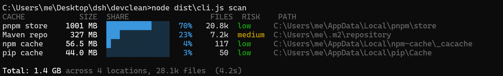
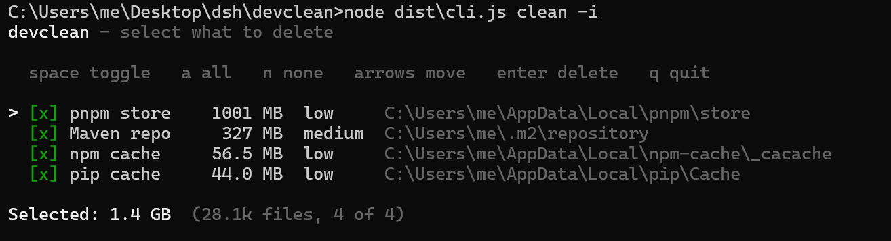
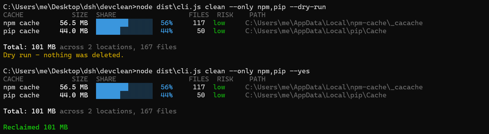
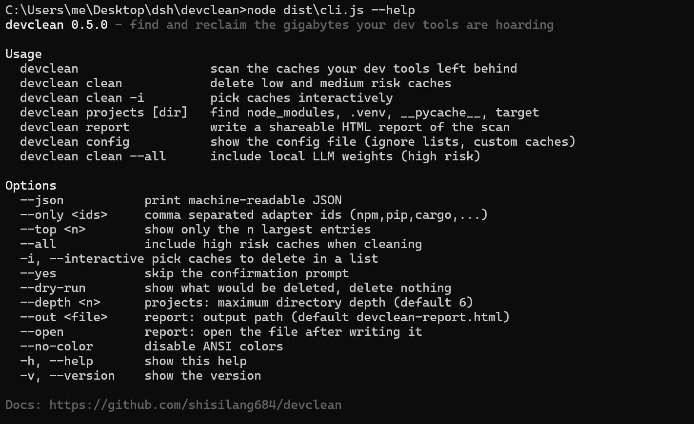
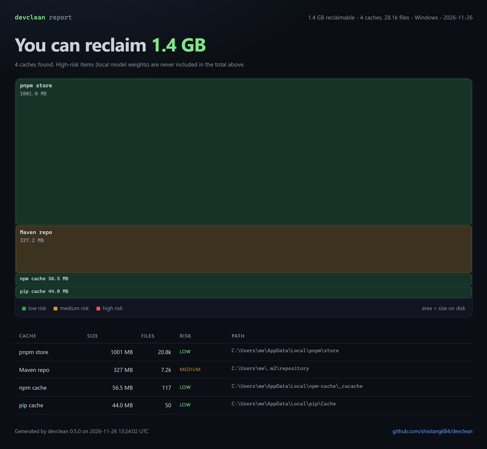

# devclean

[English](README.md) | 简体中文

[](https://github.com/shisilang684/devclean/actions/workflows/ci.yml)

**你的开发机里塞满了几个 GB 的垃圾。找到它们，看清它们，清理它们。**

`devclean` 会扫描你整条工具链悄悄攒下的缓存——npm、pnpm、pip、Cargo、Gradle、Playwright 浏览器、Hugging Face 模型、本地大模型权重——然后告诉你哪些可以安全删掉。一条命令，零配置，零遥测。



```
$ npx devclean-cache

CACHE             SIZE  SHARE            FILES  RISK    PATH
pnpm store     1001 MB  ██████████░░░░   20.8k  low     …\AppData\Local\pnpm\store
Maven repo      327 MB  ███░░░░░░░░░░░    7.2k  medium  C:\Users\me\.m2\repository
npm cache      56.5 MB  █░░░░░░░░░░░░░     117  low     …\npm-cache\_cacache
pip cache      44.0 MB  ░░░░░░░░░░░░░░      50  low     …\pip\Cache

Total: 1.4 GB across 4 locations, 28.1k files  (4.2s)
Reclaim 1.4 GB with devclean clean
```

## 为什么

每个包管理器都有缓存，每个 AI 工具都会下载模型权重，每个项目都会长出 `node_modules`。单看都不起眼，加起来就是 20–100 GB——而且没有一个工具能同时看见它们。

大多数清理工具要么只认 `node_modules`，要么把你好不容易下下来的模型权重当普通垃圾处理。`devclean` 分得清这两者。

## 快速开始

```bash
npx devclean-cache              # 扫描已知缓存
npx devclean-cache clean        # 删除低/中风险缓存（先问你）
npx devclean-cache clean -i     # 交互式勾选要删的项
npx devclean-cache projects .   # 找出项目里的 node_modules/.venv/target
npx devclean-cache report       # 生成可分享的 HTML 报告
```

需要 Node.js 20+，Windows / macOS / Linux 都能跑。不想走 registry 的话，可以直接装预编译包：`npm i -g https://github.com/shisilang684/devclean/releases/download/v0.5.0/devclean-0.5.0.tgz`。

## 长什么样

`clean -i` 把所有缓存列成勾选清单：方向键移动、空格切换、`a` 全选低/中风险项，回车后先给你看清单和总量，最后才动手：



删完它报的是实际结果，不是"预计结果"：



完整的命令面一屏就能看完：



## 扫描范围

22 类缓存，每一类都标了风险等级。

| 缓存 | 风险 | 说明 |
| --- | --- | --- |
| npm、pnpm、Yarn、Bun | 低 | 包压缩包，用的时候会重新下载 |
| pip、uv | 低 | Python wheel 和 HTTP 缓存 |
| Cargo registry、Go build cache | 低 | 编译和下载的构建输入 |
| Gradle、Maven | 低 / 中 | 依赖缓存 |
| Playwright、Puppeteer | 低 | 浏览器二进制 |
| NuGet、Composer、sbt / Ivy | 中 / 低 | .NET、PHP、Scala 依赖缓存 |
| conda | 中 | 与环境共用的包归档 |
| Deno、Cypress、Electron | 低 | 运行时、浏览器和桌面端二进制 |
| Hugging Face | 中 | 模型与数据集下载 |
| Ollama、LM Studio | **高** | 本地大模型权重，删掉就要重新完整下载 |

`clean` 默认跳过高风险缓存，除非你加 `--all`。任何删除之前都会先列出清单和总量。

## 和其他工具的区别

|  | `devclean` | `npkill` | 图形化清理软件 | `du` + `rm -rf` |
| --- | --- | --- | --- | --- |
| 包管理器缓存（npm、pnpm、pip、Cargo、Gradle…） | 22 类一次扫完 | 只认 `node_modules` | 一般不认识缓存 | 只知道你已经知道的路径 |
| 本地大模型权重（Ollama、LM Studio） | 支持，标为高风险、默认不动 | 否 | 常当普通垃圾 | 会，而且没有提醒 |
| 删除前给出风险等级 | 有 | 无 | 部分 | 无 |
| 项目产物（`node_modules`、`.venv`、`target`） | 有，只限真实项目内 | 仅 `node_modules` | 无 | 手动 |
| 可分享报告 | 自带 treemap 的 HTML | 无 | 无 | 无 |
| 安装方式 | `npx devclean-cache` | `npx npkill` | 装 App | 系统自带 |

真正拉开差距的是第二行：分不清 60 GB 模型下载和过期压缩包的工具，早晚会删掉贵的东西。

## 自定义缓存与忽略

你可以教 `devclean` 认识一个它没内置的缓存，或者把你不关心的隐藏掉，不用等发版：

```bash
devclean config
```

它会打印配置路径（Windows 是 `%APPDATA%\devclean\config.json`，macOS 是
`~/Library/Application Support/devclean/config.json`，Linux 是
`~/.config/devclean/config.json`）和当前设置。最小可用文件：

```json
{
  "ignore": ["maven"],
  "extra": [
    { "name": "Bazel cache", "path": "~/.cache/bazel", "risk": "medium" }
  ]
}
```

路径必须是绝对路径或以 `~` 开头；`risk` 不写默认 `medium`。用 `DEVCLEAN_CONFIG` 可以指定别的文件（CI 里共用一份配置很方便）。

## 项目产物

```
$ npx devclean-cache projects ~/code

CACHE              SIZE  SHARE                  FILES  RISK    PATH
node_modules     2.1 GB  ███████████░░░  72%   88.4k  low     ~/code/shop\node_modules
.venv            612 MB  ████░░░░░░░░░░  20%   12.1k  low     ~/code/api\.venv
target           240 MB  █░░░░░░░░░░░░░   8%    3.2k  low     ~/code/cli\target
```

只会报告真实项目（含 `package.json`、`pyproject.toml`、`Cargo.toml`、`.git` 等标记）里的目录，Python 标准库和已安装的软件永远不会被碰到。

## 可分享的报告

`devclean report` 会写一个自包含的 HTML 文件——不加载任何网络脚本，数据不离开你的机器。适合贴进团队 wiki、"CI 机器为什么又满了"的工单，或者给同事看看他的 80 GB 去哪了。



## 安全

- **需要预览时就不删东西。** `--dry-run` 只打印计划。
- **风险分级。** 高风险项（本地大模型权重）必须显式开启。
- **白名单。** 不属于已知缓存或项目产物的路径，即使代码有 bug 也拒绝删除。
- **从不跟随符号链接。** 缓存没法把扫描或删除引到别的地方。
- **报告不计入高风险项**，分享出去的截图不会夸大"可安全回收"的量。
- **零遥测、零网络请求。** 全部在本地完成。
- **失败会如实报告。** Windows 上被占用的文件会连同错误一起列出。
- **一下午就能审完。** 约 1,500 行零依赖 TypeScript，白名单位于 `src/adapters.ts`。

安全问题请见 [SECURITY.md](SECURITY.md)。

## 脚本化

```bash
npx devclean-cache --json | jq '.totalBytes'
npx devclean-cache clean --json --yes   # 只删低/中风险
npx devclean-cache projects . --json
```

退出码：`0` 成功，`1` 出错。

## 选项

```
--json           机器可读输出
--only <ids>     逗号分隔的缓存 id（npm,pip,cargo,...）
--top <n>        只显示最大的 n 项
--all            清理时包含高风险缓存
-i, --interactive 交互式勾选要删除的项
--yes            跳过确认
--dry-run        只显示将删除什么，不实际删除
--depth <n>      projects：最大目录深度（默认 6）
--out <file>     report：输出路径（默认 devclean-report.html）
--open           report：写完后打开文件
--no-color       关闭 ANSI 颜色
```

## 路线图

- [x] 交互式 TUI（方向键勾选要删的项）
- [ ] 增长追踪："你的缓存这周涨了 4.2 GB"
- [x] 自带 treemap 的可分享 HTML 报告
- [ ] Docker 构建缓存与 WSL 磁盘占用
- [ ] `devclean watch` 与容量预算

欢迎在 [Issues](https://github.com/shisilang684/devclean/issues) 提想法。

## 开发

```bash
git clone https://github.com/shisilang684/devclean
cd devclean
npm install
npm run build
npm test
node dist/cli.js
```

零运行时依赖，TypeScript + Node 内置测试运行器。

## 许可证

MIT